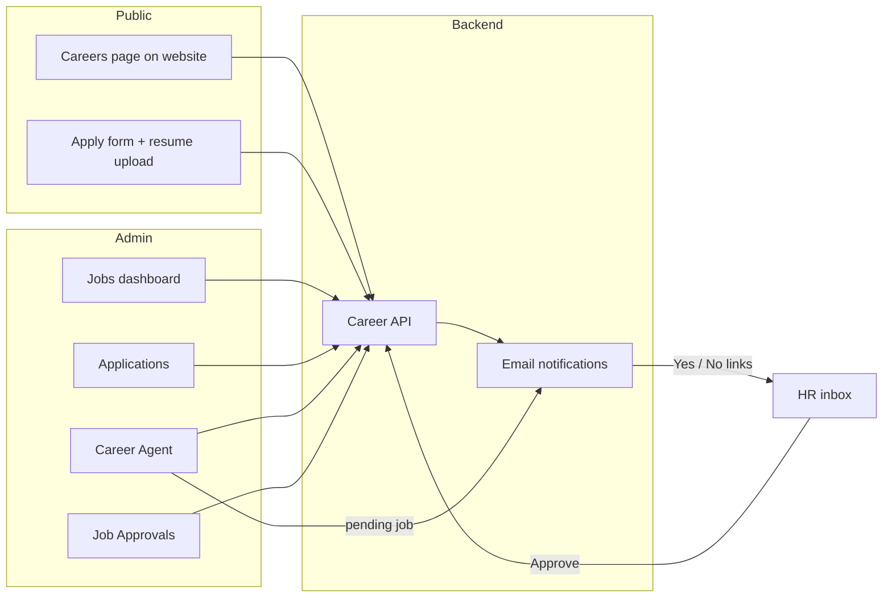

# Standard Operating Procedure (SOP): Career Page

**Document owner:** HR / Admin  
**Last updated:** October 2026  
**Applies to:** Tech2Globe public Careers page, Admin Panel → **Career** module

---

## 1. Purpose

This SOP describes how to publish job openings on the website, review candidate applications, and use the **Career Agent** (AI-assisted job drafting) with optional **HR email approval** before jobs go live.

**Goals:**

- Only **active** jobs appear on the public careers page.
- Applications are tracked in one place with clear statuses.
- HR can approve or reject AI-drafted jobs via secure email links (Yes / No).
- Sensitive actions follow role-based permissions in the admin panel.

---

## 2. Roles and access

| Role | Typical access |
|------|----------------|
| **Super Admin / Admin** | Full Career module (view, add, edit, delete) |
| **HR** | Career module only (jobs, applications, agent, approvals) |
| **Custom users** | Per-module permissions: **view**, **add**, **edit**, **delete** |

**Admin paths:**

| Area | URL path |
|------|----------|
| Jobs list | `/admin/career/jobs` |
| Create job | `/admin/career/jobs/create` |
| Edit job | `/admin/career/jobs/edit/[id]` |
| Job applications | `/admin/career/applications` |
| Career Agent (AI chat) | `/admin/career/agent` |
| Job approvals (HR email settings) | `/admin/career/approvals` |

**Read-only users:** Can view lists and details but cannot save jobs, change application status, edit guidelines, or change approval settings.

---

## 3. How the system fits together

- **Public site** loads open roles from `GET /api/career/jobs` (only `status = active`).
- **Candidates** submit via `POST /api/career/apply` (resume uploaded to cloud storage).
- **HR team** receives an email for each new application (configured via `OWNER_EMAILS` / SMTP on the server).
- **Admin panel** manages jobs, applications, AI agent, and approval settings.

---

## 4. Job statuses (important)

| Status | Meaning | Visible on public careers page? |
|--------|---------|----------------------------------|
| **active** | Open for applications | Yes |
| **inactive** | Closed / paused | No |
| **pending_approval** | Draft waiting for HR Yes/No (usually from Career Agent) | No |
| **rejected** | HR declined or approval link expired | No |

**Delete behavior:**

- If a job has **no applications**, delete removes it from the database.
- If a job **has applications**, delete **deactivates** it (`inactive`) instead of hard delete.

---

## 5. Publishing a job manually (Jobs dashboard)

Use this when HR writes the JD directly without the AI agent.

### 5.1 Create a job

1. Go to **Admin → Career → Jobs**.
2. Click **+ Create Job**.
3. Fill required fields:

   | Field | Notes |
   |-------|--------|
   | Title | Role name shown on site |
   | Experience | Free text (e.g. `2–5 Years`, `8+ Years`) |
   | Positions | Number of openings |
   | Location | Default culture: **Noida** |
   | Salary | Often **Best in the Industry** |
   | Qualification | e.g. **Any bachelors degree** |
   | Skills | Maps to **Required Skills** on the career page |
   | Responsibilities | Full JD / bullet list for **Job Responsibilities** |

4. Submit. **Manual creation does not pass through HR email approval** — the job is saved as **active** by default and goes **live immediately** unless you later change status on edit.

### 5.2 Edit or close a job

1. From **Jobs**, use **Edit** on the row.
2. Update fields and set **Status**:
   - **active** — live on site
   - **inactive** — hide from site (preferred way to “close” hiring)
   - **pending_approval** / **rejected** — use when aligning with approval workflow
3. Save.

### 5.3 Delete a job

1. Use **Delete** on the jobs list.
2. Confirm. Remember: jobs with existing applications are only **deactivated**, not removed.

---

## 6. Career Agent (AI-assisted jobs)

**Path:** Admin → Career → **Career Agent**

### 6.1 What it does

- Chat-based assistant to **list**, **create**, **update**, **close**, or **delete** jobs (within your permissions).
- Can maintain **guidelines** (tone, company rules, JD format) — editable by users with **edit** permission on Career.
- When **HR approval** is enabled, new jobs from the agent are typically saved as **`pending_approval`** and HR receives a **“Do you want to publish?”** email with **Yes** / **No** (and preview) links.

### 6.2 Recommended prompt pattern for HR staff

1. State role title, experience, location, and number of positions.
2. Paste or describe skills and responsibilities (bullets are fine).
3. Ask explicitly: *“Create this job and send for HR approval”* if approval is on.
4. Use the agent to **check approval status** by job ID if waiting on email.

### 6.3 Agent vs manual create

| Method | HR email approval | Default visibility |
|--------|-------------------|--------------------|
| **Career Agent** (approval ON) | Yes → `pending_approval` until HR clicks Yes | Not live until approved |
| **Jobs → Create Job** | No automatic approval email | **Live immediately** (`active`) |

Coordinate with your team so urgent roles use the path you intend (manual vs agent).

---

## 7. HR job approval (email Yes / No)

**Path:** Admin → Career → **Job Approvals**

### 7.1 Settings

| Setting | Purpose | Typical value |
|---------|---------|----------------|
| Enable approval system | Master switch for approval emails | On |
| Require HR Yes/No before publish | Agent-created jobs stay pending | On |
| HR approval emails | Comma-separated recipients | e.g. `hr@tech2globe.com` |
| Reminder after (hours) | Resend if no response | 24 |
| Max reminders | Limit reminder emails | 2 |
| Link expiry (hours) | After expiry, pending may become rejected | 168 (7 days) |

**Save settings** after changes. Use **Send test email** to verify SMTP and recipient list.

**Server requirement:** `BACKEND_PUBLIC_URL` must be set on the API server so Approve/Reject links in emails work. If missing, the admin page shows a warning.

### 7.2 HR actions from email

1. Open the approval email from the Career Agent flow.
2. **Preview** — review JD before deciding.
3. **Yes (Approve)** — job status becomes **active** → appears on careers page.
4. **No (Reject)** — job marked **rejected** → not published.
5. **No response** — system sends reminders (per settings), then may **expire** (default: rejected after expiry).
6. **Live jobs list** — the email includes a numbered table of every job currently **active** on the public careers page (newest first).
7. **Remove by number** — click **Open remove-by-number page**, enter the list **#**, and confirm. That job is set to **inactive** and disappears from the website (applications stay in admin). The link expires with the same deadline as the approval email.

### 7.3 Resend approval

- On **Job Approvals**, use **Resend** for a pending job if HR did not receive email or link expired early.
- Requires **edit** permission on Career.

---

## 8. Managing job applications

**Path:** Admin → Career → **Job Applications**

### 8.1 When a candidate applies (automatic)

1. Candidate selects an **active** job on the website and submits the form + resume.
2. System validates required fields: name, email, phone, job.
3. **Duplicate rule:** same email + same job cannot re-apply within **90 days** (cooldown).
4. Application is stored with status **pending**.
5. HR receives email **“Job Request - [Candidate Name]”** with details and resume link (reply-to = candidate email).

### 8.2 Review in admin

1. Open **Job Applications**.
2. Filter by status or search by name/email.
3. Open a row to view full details (CTC, notice period, LinkedIn, portfolio, comments, resume link).
4. Update status:

   | Status | When to use |
   |--------|-------------|
   **pending** | New, not yet reviewed |
   **shortlisted** | Moving to interview pipeline |
   **hired** | Offer accepted / joined |
   **rejected** | Not proceeding |

5. Contact candidates via **mailto** links or phone from the detail view.

### 8.3 Daily HR checklist (applications)

- [ ] Clear new **pending** applications (same business day if possible).
- [ ] Move progressed candidates to **shortlisted** or **rejected**.
- [ ] Mark **hired** when confirmed.
- [ ] Download/open resume from detail modal before interviews.

---

## 9. Public careers page (reference for content owners)

What candidates see per job (from active job record):

- Title, experience, positions, location, qualification, salary  
- **Required Skills** ← `skills` field  
- **Job Responsibilities** ← `responsibilities` field  

Apply form collects (among others): name, email, phone, resume, optional portfolio/LinkedIn, CTC, notice period, join date, last company, comments.

---

## 10. Troubleshooting

| Issue | Likely cause | Action |
|-------|--------------|--------|
| Job not on website | Status not **active** | Edit job or wait for HR **Yes** on approval |
| HR never got approval email | Wrong emails / SMTP | Job Approvals → fix recipients → **Test email**; check spam |
| Approve link error | `BACKEND_PUBLIC_URL` missing | Set on API server; retry **Resend** |
| Agent job stuck pending | HR has not clicked Yes/No | Resend approval; check expiry settings |
| Manual job went live without review | Manual create defaults to **active** | Use **inactive** until ready, or use Agent + approval |
| Cannot delete job | Has applications | Use **inactive** to close instead |
| Candidate “already applied” | 90-day cooldown | Wait or use different email only if legitimate new application policy allows |
| No application emails | `OWNER_EMAILS` / SMTP | Verify backend env and mail logs |

---

## 11. Security and compliance notes

- Admin actions require login and Career module permission.
- Approval decisions use **signed links** (no need to parse Yes/No from inbox replies for the decision itself).
- Resumes are stored as URLs from the upload provider; treat links as confidential.
- Do not share admin credentials; use HR role accounts with least privilege.

---

## 12. Quick reference — who does what

| Task | Owner | Where |
|------|--------|--------|
| Write & publish job (no AI) | HR / Recruiter | Jobs → Create / Edit |
| Draft job with AI + HR gate | HR + approver | Career Agent + email Yes/No |
| Configure approval emails | HR lead / Admin | Job Approvals |
| Triage applications | HR | Job Applications |
| Close hiring | HR | Edit job → **inactive** or Agent “close job” |
| Fix email / links | DevOps / Admin | Server env: SMTP, `BACKEND_PUBLIC_URL`, `OWNER_EMAILS` |

---

## 13. Document control

- Update this SOP when approval defaults, cooldown days, or admin URLs change.
- Technical source of truth: `tech2globe-adminpanel` (Career UI) and `tech2globe-backend` (`/api/career`, Career Agent, approval scheduler).

**Related backend endpoints (for IT):**

- Public: `/api/career/jobs`, `/api/career/apply`, `/api/career/check-application`
- Admin: `/api/career/admin/*`
- Agent: `/api/agents/career/*`
- Public approval links: `/api/career/approvals/go`
